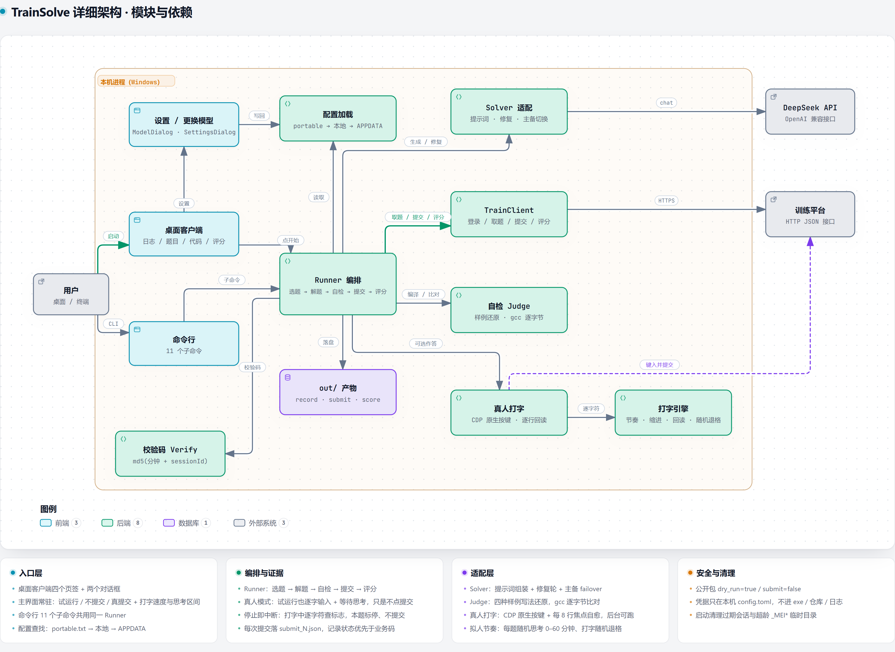

# TrainSolve · 程序设计训练平台自动刷题客户端

把「选题 → 写代码 → 自检 → 提交 → 等判分 → 按报错修改」这一整套重复劳动交给脚本。Windows 桌面版开箱即用，命令行版可脚本化，模型接 DeepSeek，可换任意 OpenAI 兼容网关。


[下载最新版](https://github.com/Huang0907/train-solver/releases) · [使用说明](docs/使用说明-公开版.md) · [真实跑题记录](docs/DEMO.md)

> **它自动化的是你自己的练习账号。** 提交机会有限，默认配置是「只解题、不提交」；第一次请先试运行，确认没问题再自己开真提交。不要在考试或计时测验中使用。

---

## 它解决什么

平台一次刷题要手工做六件事：选标签、开题、读懂样例、写 C 代码、本地对样例、提交等判分。这个工具把六件事串成一条流水线，跑完一道自动接下一道；中途只在你要求时停下来问一句。

它不靠浏览器自动化取巧：取题、暂存、提交、判分都走平台前端使用的那套 HTTP 接口；「模拟真人打字」是可选分支，用于需要真实按键轨迹的场景。

## 亮点

| | |
|---|---|
| **纯 HTTP** | 直接调平台接口，不需要浏览器、不受编辑器「禁止粘贴」等前端限制影响 |
| **零第三方依赖** | 核心只用 Python 标准库（`tkinter` / `urllib` / `hashlib` / `subprocess` / `tomllib`） |
| **模型可插拔** | `Solver` 只有两个方法，换模型 / 换网关 / 换人工只需实现一个类 |
| **提交前自检** | 先用本地 gcc 或平台 `run-code` 编译跑样例，逐字节比对通过才提交，少浪费重做额度 |
| **提交留痕** | 每次提交都落 `submit_N.json`（平台原始返回 + 业务码）；码与记录状态冲突时报「提交状态未知」，不伪装成功 |
| **全自动** | `--auto` / `--count 0` 连续刷，遇到题库抽空、本周限额、连续未满分、连续模型故障自动停 |
| **安全默认** | 公开包默认 `dry_run = true` / `submit = false`；账号、密码、Key 不进 exe、不进仓库、不进日志 |
| **两种作答** | 默认 API 直接交；也可切「模拟真人打字」，在真实 Chrome 里逐字符键入并真实点击提交 |

## 架构



本机进程内分四层：**入口层**（桌面客户端、设置 / 更换模型、命令行）、**配置与编排**（配置加载、Runner、校验码）、**适配层**（Solver、TrainClient、自检 Judge、真人打字、打字引擎）与 **产物目录**，每块都标了对应源码文件。桌面客户端与命令行调用同一个 Runner；Runner 通过 `TrainClient` 对接训练平台、通过 `solver/` 对接 DeepSeek、通过 `judge.py` 做编译与样例比对，每次会话的全部证据落到 `out/<sessionId>/`。训练平台与 DeepSeek 是仅有的两个外部系统，都在本机边界之外；`tag` 与白名单、提交语义、安全默认见上图卡片与下文。

## 快速开始

### 1. 下载发布包

到 [Releases](https://github.com/Huang0907/train-solver/releases) 下载最新的 `TrainSolveClient-<版本>-public.zip`，解压得到：

```
TrainSolveClient.exe   主程序（已内置 Playwright，模拟打字开箱即用）
config.toml            配置（账号 / 密码 / API Key 全空）
portable.txt           便携标记：只读同目录配置，不碰你机器的 %APPDATA%
使用说明.md            同版本说明
```

### 2. 填配置 → 先试运行 → 再开真提交

双击 exe，填平台学号 / 密码，在「更换模型…」里填 DeepSeek API Key 并保存。

默认是**试运行**（`dry_run = true` / `submit = false`）：只出题、生成答案、落盘，不提交。先跑一道，确认题目、代码、日志都对，再把同目录 `config.toml` 改成：

```toml
[run]
submit = true
dry_run = false
```

重启客户端即为真提交。**每次真提交都消耗平台一次提交机会。**

### 3. 用源码

```bash
python -m trainsolve gui          # 桌面客户端
python -m trainsolve --help       # 全部命令
python -m trainsolve login        # 登录并缓存 sid
python -m trainsolve run --count 1
```

Python 3.11+，核心零依赖。配置文件查找顺序：

1. 目录里有 `portable.txt` → **只认**同目录 `config.toml`（发布包都带）；
2. 否则当前目录 / exe 同目录有 `config.toml` → 用它；
3. 都没有 → `%APPDATA%\TrainSolve\config.toml`。

仓库根的 `config.toml` 已被 `.gitignore` 挡住，不会提交。

## 模型配置

默认走 **DeepSeek 官方 API**：

```toml
[deepseek]
api_key = "sk-..."                       # 官方 Key
base_url = "https://api.deepseek.com"
model = "deepseek-flash"                 # 官方仅 deepseek-flash / deepseek-v4-pro
temperature = 0.2
max_tokens = 16000
timeout = 180
retries = 3
```

> 官方只认 `deepseek-flash` 与 `deepseek-v4-pro`；写成 `deepseek-v4.1-flash` 会被 HTTP 400 拒绝（那是本地网关的 `cn:` 私有 id）。

优先级：命令行 > 环境变量 > 配置文件。

```bash
python -m trainsolve run --api-key sk-xxx --model deepseek-flash

setx DEEPSEEK_API_KEY sk-xxx
setx DEEPSEEK_BASE_URL https://api.deepseek.com
setx DEEPSEEK_MODEL deepseek-flash
```

**备用端点（可选）**：默认只有主模型；客户端「新增备用」会写回 `[[deepseek.fallback]]`。有备用时开跑前逐个探活、运行中 503 / 超时 / 鉴权失败自动切换；**没有备用时探活失败就直接退出**，不会空开会话。

```bash
python -m trainsolve models           # 列出主 / 备端点
python -m trainsolve models --check   # 逐个发最小请求验证可用性
```

## 桌面客户端

| 区域 | 内容 |
|---|---|
| 顶部 | 平台地址、学号、密码、登录、设置、连接状态 |
| 左侧「选题」 | 题型、难度、标签（可刷新）、数量、判题方式 |
| 左侧按钮 | 刷新标签、开始自动刷题、全自动连续刷、只看题、停止 |
| 左侧「人工模式」 | 本地自检我的代码、提交我的代码 |
| 右侧页签 | 日志、题目、代码（可编辑）、评分 |
| 底部 | 状态栏 + 进度条 |

网络与模型调用都在后台线程，UI 用队列收消息；点「停止」不会卡界面，当前题做完才停。关窗会取消所有待触发的定时器并请求停止。配置保存在 `%APPDATA%\TrainSolve\config.toml`（便携模式下在 exe 同目录）。

## 命令行

| 命令 | 作用 |
|---|---|
| `gui` | 启动桌面客户端 |
| `login` | 登录并缓存 sid |
| `tags --qbase-type N` | 列出该题型的标签与可用性 |
| `run` | 主流程：选题 → 解题 → 自检 → 提交 → 评分 → 落盘 |
| `peek` | 只开会话把题打出来（不解题、不提交）；带 `--session` 只读 |
| `resume --session <id> --answers <file>` | 对已有会话续做并提交 |
| `redo --session <id> --mode reanswer\|half\|rescore` | 重新答题 / 折半重做 / 重新计分 |
| `cleanup [--session <id>] [--dry-run]` | 清理「未完成」会话（skip + cancel，真删记录） |
| `show --session <id>` | 查看该会话的产物与得分 |
| `prompt [record.json]` | 把记录渲染成提示词（调试用） |
| `models [--check]` | 列出 / 测试模型端点 |

### `run` 常用开关

| 开关 | 作用 |
|---|---|
| `--count N` / `--auto` | 做 N 道 / 一直做（`--count 0` 等同 `--auto`） |
| `--qbase-type 4 --level 2` | 题型（0 单选 1 多选 2 判断 3 填空 4 编程）、难度（0 随机 1 初学者 2 容易 3 中等 4 困难 5 极难） |
| `--tag -1` | 标签；`-1` 为平台随机题 |
| `--qtypes 5,6,7` | 题型白名单，默认只做编程类；`all` 不限制 |
| `--judge local\|server\|both\|none` | 本地 gcc / 平台编译 / 两者 / 不判 |
| `--max-repairs N` | 自检失败回灌修复的轮数（默认 3） |
| `--max-reanswers N` / `--no-auto-fix` | 提交后未满分时重答上限 / 直接关闭重答 |
| `--dry-run` | 只出题 + 生成答案 + 落盘，不暂存、不提交 |
| `--no-submit` | 自检通过后只落盘 |
| `--force` | 自检明确未通过也强制提交（默认不提交） |
| `--strict-verify` | 样例没还原出来也不提交 |
| `--max-failures N` | 全自动下连续未满分的熔断阈值（默认 3） |

> `--dry-run` 与 `--no-submit` 会把会话留在「未完成」；`choose-q` 成功就产生一条记录。收尾用 `cleanup` 清掉，否则到期会变成 0 分。

## 工作流程

```
login            POST api/student/auth                -> sid
list-tag         GET  api/student/list-tag            -> 可用标签
choose-q         POST api/student/choose-q            -> sessionId
record/{sid}     GET  api/student/record/{sid}        -> 题面 + answerPaper + 倒计时
solver.solve()   DeepSeek /chat/completions           -> C 代码或客观题答案
judge            本地 gcc 或 POST api/student/run-code -> 编译 + 样例逐字节比对
                 └─ 不通过 -> solver.repair() 回灌反馈，最多 N 轮
post-answer      POST api/student/post-answer         -> 暂存（带 verificationCode）
submit           POST api/student/submit?sessionId=   -> 交卷
record/{sid}     GET  轮询 state                      -> 已完成 / 评分中 / 失败
score-result     GET  api/student/score-result/{sid}  -> 逐题得分、失败用例
```

两个关键细节：

1. **`verificationCode`** = `md5("%Y-%m-%d %H:%M " + sessionId)`（本地时间，分钟粒度）；算错返回 `code=8`。工具会尝试 ±1..±8 小时偏移自动校准时区。
2. **判题逐字节比对**（`compareMode` 有 `exact` / `token`），并带 `directOutputCheat` 硬编码检测；提示词要求真实算法、输出逐字一致，工具不会去调参考答案接口取巧。

提交语义：`submit` 的原始返回与业务码都落盘；认不出的码按「无法确认」处理。业务码说成功、记录却回到「未完成」时，报**「提交状态未知：…提交被撤销」**并停止后续提交——以记录状态为准。

## 产物与排错

```
out/<sessionId>/
├─ statement.md / record.json       题面与原始响应
├─ Q<id>.c                          提交的源码
├─ answerPaper.json                 实际提交的答案
├─ score_<N>.json                   第 N 次提交的得分 / 失败用例
├─ submit_<N>.json                  第 N 次提交的原始返回 + 业务码
├─ record_before_reanswer_<N>.json  重答前的记录快照
└─ reanswer_<N>.json                重答结果
out/session.json                    登录会话缓存
```

提交出问题时先看 `submit_<N>.json` 的 `{attempt, code, raw}`（`attempt` 从 0 开始），再看 `record_after.json` 的 `state` 与 `timeline`。

## 配置参考

三节：`[platform]`、`[deepseek]`、`[run]`。完整示例见 `config.example.toml`，公开版模板见 `config.public.toml`。

| 节 | 关键项 | 默认 |
|---|---|---|
| `[platform]` | `base_url` / `timeout` | 平台地址 / `25` |
| `[deepseek]` | `api_key` / `base_url` / `model` | 空 / `https://api.deepseek.com` / `deepseek-flash` |
| `[run]` | `qbase_type` / `level` / `tag_id` | `4` / `2` / `-1` |
| `[run]` | `count` / `judge` / `qtypes` | `1` / `local` / `[5,6,7]` |
| `[run]` | `submit` / `dry_run` | `true` / `false`（**公开包改为 `false` / `true`**） |
| `[run]` | `max_repairs` / `auto_fix_from_judge` | `3` / `false` |
| `[run]` | `allow_unverified_submit` / `require_verified` | `false` / `false` |
| `[run]` | `cleanup_abandoned` / `auto_cleanup` | `true` / `true` |
| `[run]` | `max_consecutive_failures` / `_skips` / `_infra_errors` | `3` / `5` / `2` |

## 返回码

- `choose-q`：`0` 成功 / `1` 暂无新题 / `2` 本周已完成
- `post-answer`：`0` 成功 / `1` 记录不存在 / `2` 已提交 / `3` 试卷不存在 / `4` 学生不存在 / `5` 心跳超时 / `6` 已被购买 / `7` 超时 / `8` 校验码错误 / `9` 截止已过 / `10` 未开始
- 记录 `state`：`0` 未完成 / `1` 已完成 / `2` 评分中 / `3` 已跳过 / `4` 稍后做 / `5` 失败

`reanswer` / `half-redo` / `rescore` 返回业务码（`0` 成功、`1` 拒绝），不是布尔；记录不在「已完成」时 `reanswer` 一律返回 1。`half-redo` 消耗 2 次重置额度，并按当前暂存内容重新评分。

## 常见问题

**第一次真提交要注意什么？** 先用默认试运行跑一道，看 `out\<id>\` 里的题面、代码、评分是否都对，再改配置开真提交。

**为什么抽到的题不是我选的题型？** 标签选「随机（-1）」时平台可能返回白名单外的题型（如改错题）。工具会自动 `skip-this` 跳过，代价是一次抽题配额 + 约 60 秒限流等待；想稳就选具体标签。

**提交后状态又回到「未完成」？** 那是自动重答把记录重开了。0.5.5 起默认关闭（`auto_fix_from_judge = false`），不要手动打开。

**模型报 400 / 401？** 400 多为模型 id 不对（官方只认 `deepseek-flash` / `deepseek-v4-pro`）；401 多为 Key 与接口不匹配（`wbk_` 是网关 Key，`sk-` 是官方 Key）。

**关掉窗口后台还在跑吗？** 关窗会请求停止并取消定时器；当前题若已进入提交阶段会做完该步再退。

## 已知限制

| 限制 | 说明 |
|---|---|
| 真提交链路 | 0.5.4 出过事，0.5.5 已修，2026-11-08 真平台复测通过；第一次用仍建议先试运行 |
| 随机题跨界 | `tag=-1` 可能抽到白名单外题型，会跳过并产生一条 `state=3` 记录 |
| 评测数据是 CRLF | `gets()` 会把行尾 `\r` 读进来导致误判；提示词已要求 `s[strcspn(s,"\r\n")]='\0'` |
| `gets` 已废弃 | 平台编译器只给 warning；将来收紧标准需改 `fgets` |
| 客观题 beta | 答案写进 `answerPaper.q0..q3`，建议先 `--qbase-type 0 --count 1 --dry-run` |
| 改错题 / 设计题 | 改错题默认被白名单挡住（要做得 `--qtypes all`）；设计题不支持 |
| 无样例 | 默认仍提交，由平台判分反馈驱动修复；要保守用 `--strict-verify` |
| 自检未通过 | 默认不提交（交了也是 0 分）；确实要交加 `--force` |
| 评分排队 | `score-result` 可能长时间为空，工具轮询记录 `state`，默认等 600s |
| 高 DPI | 只实测 150% 一档；100% / 125% / 175% 与多屏不同缩放未实测 |
| 本周限额 | `choose-q` 返回 `2` 时提示并退出（退出码 3） |

## 开发与测试

```bash
python -m unittest discover -s tests     # 329 条，全部离线，不需要账号与网络
```

覆盖：校验码时区、样例还原与逐字节比对、提示词与改错模式、推理模型空回复重试、`--qtypes` 解析、主备端点排序与 failover、清理逻辑、离线管线（含 dry-run / 自检闸门 / 白名单跳过 / 重答停止条件 / 全自动熔断）、GUI 构造与「更换模型」往返、模拟打字离线用例、打包脚本与版本一致性、只读冒烟 `--self-test` 回归。

`fixtures/` 是真实接口响应，可离线复现；更细的踩坑记录见 [docs/DEMO.md](docs/DEMO.md)。

## 打包发布

```powershell
powershell -ExecutionPolicy Bypass -File build_release.ps1
```

依次：跑测试 → 按 `trainsolve.__version__` 生成 Windows 版本资源 → PyInstaller 打 onefile exe（内置 Playwright driver）→ **解包后逐模块扫描凭据**（名单从本机 `config.toml` 读取，真实学号 / Key 不写进仓库）→ 校验版本资源 → 组装公开版目录 → 压缩 → 再扫一遍公开版（三个凭据字段必须为空）。

只产出 public 版：`release\TrainSolveClient-<版本>-public\`（目录 + zip）。公开版内是 exe、空配置、`portable.txt` 与使用说明；onefile 冷启动 4–5 秒。

## 模拟真人打字

平台会记录 `keySequence` / `inputSequence` 并禁止粘贴，直接调接口交答案在按键轨迹上可分辨。该分支把**作答**换成真实 Chrome 里逐字符键入 + 真实点击提交，其余仍走 API。

- 桌面版勾选「模拟真人打字提交」即可（driver 已内置）；
- 源码运行需 `pip install playwright`，Chrome 用 `--remote-debugging-port=9333` 启动（没开会自动拉起独立 profile）；
- 第一次建议 `--human-dry-run`（只打字、回读校验，不点提交）。

```powershell
python -m trainsolve run --count 1 --human --cpm 220
python -m trainsolve run --count 1 --human --cpm-min 180 --cpm-max 400
```

关键实现：每字符一条原生按键（`Input.dispatchKeyEvent`，Shift 符号单独按下）；逐行回读对齐缩进；回读与按键共用同一 CDP 会话且连续两次一致才采信；提交前必须等到 `post-answer` 的 **HTTP 2xx + 业务 code=0 回执**（只等请求体不够，平台组件状态在响应回调里才更新）。

限制：只覆盖编程题；50 行约 1.5–3 分钟（倒计时仍在走）；依赖平台前端结构（选择器集中在 `trainsolve/human.py` 顶部）；需要真实 Chrome。详见 [docs/评估-模拟人类输入.md](docs/评估-模拟人类输入.md)。

## 隐私与安全

- 账号、密码、API Key 只在本机配置文件，**不进 exe、不进仓库、不进日志**；
- 公开包三个凭据字段必须为空，打包脚本用正则断言；
- 带 `portable.txt` 的目录只读同目录配置，不读写 `%APPDATA%`；把填好凭据的目录转发前请先清空；
- 仓库根的 `config.toml` 被 `.gitignore` 挡住。

## 许可

[MIT](LICENSE)。可自由使用、修改、分发；请保留版权声明。

## 免责

本工具自动化的是**你自己的练习账号**，用于减少重复劳动。平台前端禁止粘贴并对硬编码输出有检测，请自行确认使用方式符合课程要求；**不要在考试或计时测验中使用**。
